# CVMaster Component Inventory

**Target Application**: `https://cvmaster.app/`  
**Primary Evidence Records**:
- `ev_fa6d6e41c78e797a47fa1b2f2b72a9d47c21a4d92c833522fd2fe363d8fc5950` (`inspect_web_page` with DOM, AX tree, and script inventory)
- `ev_aa23f6dbd7756f79a749b8b1da8825cfd0d8f7cef63488cab739b619d75f971d` (`export_web_scripts`)
- `ev_9f1622136e724145a2541fd1139a2fbbf85523b588895c404b9a01e018973bf5` (`analyze_javascript_application` on core bundles)
- `ev_d4721be36551ad83b213a9ce8e88eb21139d01a77308e34ce54e9050fed14e11` (`analyze_javascript_application` on lazy chunks)
- `ev_5c7ff687c41ba2d956c4b0ad4f650d6a8c92e69697d94efe53263f18b4201846` (`capture_browser_scenario` fetching lazy chunks `DndSections-CIlCdOj4.js` and `ReviewPage-BNk1S44H.js`)

---

## 1. High-Level Component Hierarchy

```mermaid
flowchart TD
    Root["wf (App Root & BrowserRouter)"] --> Routes["Routes"]
    Root --> Toaster["ai (Radix Toast Provider)"]
    Routes --> HomeRoute["/ -> yf (Main Workspace)"]
    Routes --> ReviewRoute["/review -> Suspense -> ce (ReviewPage)"]

    HomeRoute --> Theme1["Li (ThemeProvider)"]
    Theme1 --> Splash["Ki (Splash Loader - 500ms first session visit)"]
    Theme1 --> Header["vf (Top Navigation Bar)"]
    Theme1 --> DesktopSplit["Desktop Split View (hidden lg:flex)"]
    Theme1 --> MobileTabs["Mobile Tabs (lg:hidden, Tabs: editor | preview)"]

    Header --> ControlsSheet["Sa (Controls Left Sheet)"]
    Header --> ReviewDialog["Ma (CV Review Dialog)"]
    Header --> ResetModal["Kp (Reset AlertDialog)"]
    Header --> ImportDialog["ff (Import Dialog: JSON / PDF / Image)"]
    Header --> ExportMenu["gf (Export DropdownMenu: PDF / JSON)"]
    Header --> ThemeToggle["Mi (Theme DropdownMenu: Light / Dark / System)"]

    ControlsSheet --> FontPicker["mu / du (Font Category + Command Search + Lazy Font Loader)"]
    ControlsSheet --> Sliders["ya (Sliders: Font Size, Line Height, Vertical Spacing, Margin)"]
    ControlsSheet --> Radios["ba (RadioGroups: Header Alignment, Skills Layout)"]
    ControlsSheet --> DndSections["Suspense -> W / K (DndSections Sortable List)"]

    DesktopSplit --> LeftSidebar["up (Editor Sidebar)"]
    DesktopSplit --> RightCanvas["Ca (Zoom/Pan Canvas)"]

    LeftSidebar --> BasicsCard["dp (Basics Accordion Card)"]
    BasicsCard --> PhotoUploader["ip (Photo Upload & Styling Controls)"]
    BasicsCard --> CustomFields["op (Custom Fields Editor)"]

    LeftSidebar --> SectionCard["cp (Reusable Section Accordion Card x9)"]
    SectionCard --> SummaryEditor["Ue (Tiptap Rich Text Editor for Summary)"]
    SectionCard --> SectionItemRow["ap (Section Item Row + Edit/Hide/Delete Menu)"]
    SectionCard --> SectionModals["fp / gp / vp / jp / bp / Sp / Pp / Tp (8 Section Item Form Dialogs)"]

    RightCanvas --> FloatingToolbar["Su (Zoom/Reset/Center/Page-Break Floating Bar)"]
    RightCanvas --> ResumeSheet["$r (#cv-preview A4 Sheet Container)"]
    ResumeSheet --> BasicsPreview["eu (Header / Basics Block)"]
    ResumeSheet --> SectionPreviews["tu / nu / ou / au / iu / lu / cu / su / uu (9 Section Renderers)"]
    ResumeSheet --> PageBreakLine["fu (Dashed Red Page Break Indicator)"]

    ReviewRoute --> ReviewHeader["vf (Top Navigation Bar with 'Back to Editor')"]
    ReviewRoute --> ReportBody["q (AI Review Report Container)"]
    ReportBody --> Gauges["c (SVG Circular Score Gauges)"]
    ReportBody --> ReportTabs["J (Overview) / W (Detailed Analysis) / Z (Recommendations) / Q (Improvements)"]
```

---

## 2. Application Shell, Theme & Splash Components

### Finding CI-01: Root Router, Theme Provider, and First-Visit Splash Screen (`wf`, `yf`, `Li`, `Mi`, `Ki`)
- **Description**:
  - **Root (`wf`)**: Renders `<BrowserRouter>`, `<Routes>` (`/` -> `yf`, `/review` -> `Suspense` wrapping lazy `bf` / `ce`), and `<ai />` (Radix Toast viewport).
  - **Workspace Shell (`yf`)**:
    - Invokes `$l()` (`wl` in `assets/utils-C_1XUkXG.js`), which locks `document.body.style.overflow = "hidden"` while mounted so only internal panes scroll.
    - Tracks `isLoading` state initialized via `!sessionStorage.getItem("hasVisited")`. On the first load in a browser tab session, displays `<Ki message="Loading CV Master..." />` for `500` ms (`setTimeout`) before setting `sessionStorage.setItem("hasVisited", "true")`.
    - Tracks `previewMode` (`boolean`, default `false`) to collapse the left sidebar on desktop (`lg:flex`) and expand the preview canvas to `100%` width.
    - Reads viewport width via `We()` (`useWindowSize`).
  - **Theme System (`Li`, `Mi`)**:
    - `Li` provides `{ theme, setTheme }` persisted in `localStorage["cv-master-theme"]` (default `"system"`), toggling `.light` or `.dark` on `document.documentElement`.
    - `Mi` renders a Radix `DropdownMenu` trigger button (`aria-label="Toggle theme"`) with `Sun` and `Moon` icons and three options: `Light`, `Dark`, and `System`.
- **Evidence source**:
  - `assets/index-B9ESfVPA.js` (symbols `wf`, `yf`, `Li`, `Mi`, `Ki`)
  - `assets/utils-C_1XUkXG.js` (hooks `wl` / `useLockBodyScroll` and `bl` / `useWindowSize`)
  - `ev_fa6d6e41c78e797a47fa1b2f2b72a9d47c21a4d92c833522fd2fe363d8fc5950` (DOM `<html class="dark">`, AX tree button `"Toggle theme"`)
- **Verification status**: `Verified`
- **Implementation implications**:
  - Implement a `ThemeProvider` supporting `"light" | "dark" | "system"` backed by `localStorage`.
  - Lock `body` overflow on the main workspace route while keeping `body` scrollable on `/review`.

---

## 3. Top Navigation Bar & Global Action Modals (`vf`, `Ma`, `Kp`, `ff`, `gf`)

### Finding CI-02: Route-Aware Top Header (`vf`)
- **Description**:
  - Renders a sticky `h-16` (`64px`) header `<header class="w-full border-b bg-background/95 backdrop-blur supports-[backdrop-filter]:bg-background/60">`.
  - Checks `useLocation().pathname === "/"`:
    - **Left cluster**: On `/` at `<1024px` (`block lg:hidden`), renders `<Sa />` (`Controls` drawer trigger) to the left of the logo; at `>=1024px` (`hidden lg:flex`), renders `<Sa />` to the right of the brand title (`CV Master`) and separator.
    - **Right cluster on `/`**:
      - `<Ma />` (`CV Review` dialog trigger button)
      - Desktop-only (`hidden lg:flex`) `Preview` toggle button (`aria-pressed={previewMode}`, `title="Toggle preview mode"`)
      - `<Kp />` (`Reset` confirmation dialog trigger button)
      - `<ff />` (`Import` modal trigger button)
      - `<gf />` (`Export` dropdown menu trigger button)
      - `<Mi />` (`Toggle theme` dropdown menu button)
      - GitHub link `<a href="https://github.com/leomosley/cv-master" target="_blank" aria-label="View source on GitHub">`
    - **Right cluster on `/review`**:
      - Replaces editor controls with a `"Back to Editor"` button (`navigate("/")`), `<Mi />`, and the GitHub repository link.
- **Evidence source**:
  - `assets/index-B9ESfVPA.js` (symbol `vf`)
  - `ev_fa6d6e41c78e797a47fa1b2f2b72a9d47c21a4d92c833522fd2fe363d8fc5950` (DOM nodeIds `11`–`107`, AX banner node)
- **Verification status**: `Verified`
- **Implementation implications**:
  - Avoid rendering two separate `<Sa />` instances simultaneously in the DOM if testing with strict single-locator selectors, or scopes selectors to visible containers; in our clean implementation, a single responsive flex order or media-query check avoids duplicate hidden triggers.

### Finding CI-03: Reset Confirmation Modal (`Kp`)
- **Description**:
  - Uses Radix `AlertDialog` (`AlertDialogTrigger`, `AlertDialogContent`, `AlertDialogTitle`, `AlertDialogDescription`, `AlertDialogCancel`, `AlertDialogAction`).
  - Displays title `"Reset Resume?"` and warning text `"Are you sure you want to reset your resume? This will replace all your current data with the default template and cannot be undone."`.
  - Confirming calls `resetAll()` on the `Y` (`cv-storage`) store, which restores default resume data (`zd`), default section order (`Qd`), empties `hiddenItemIds`, removes `localStorage.getItem("cv-storage")`, and triggers a toast `"Resume reset successfully"`.
- **Evidence source**:
  - `assets/index-B9ESfVPA.js` (symbol `Kp`)
  - `assets/state-LogT9lEE.js` (action `resetAll` in store `Y`)
- **Verification status**: `Verified`
- **Implementation implications**:
  - Provide a destructive confirmation dialog before wiping persisted resume state.

---

## 4. Controls Drawer & Section Drag-and-Drop (`Sa`, `mu`, `du`, `ya`, `ba`, `W`, `K`)

### Finding CI-04: Controls Left Sheet & Typography/Layout Controls (`Sa`, `mu`, `du`, `ya`, `ba`)
- **Description**:
  - `Sa` renders a Radix `Sheet` (`side="left"`, `w-[320px] sm:w-[400px] overflow-y-auto`) titled `"Controls"`.
  - Reads and mutates the `ee` (`controls-storage`) Zustand store:
    1. **Font Category (`Select`)**: Options from `Hr = ["ATS-Friendly", "sans-serif", "serif", "display", "monospace", "handwriting"]`. Switching category filters available fonts and selects the first font in that category if the current font is not present.
    2. **Font Family Combobox (`mu` & `du`)**: Radix `Popover` + `cmdk` (`CommandInput` `"Search fonts..."`, `CommandList`, `CommandEmpty` `"No font found."`). Each item (`du`) uses `bl` (`useIntersectionObserver`) to call `wu(fontFamily)` when scrolled into view, dynamically injecting `<link rel="stylesheet" href="https://fonts.googleapis.com/css?family=...&display=swap">` into `document.head` so each option renders in its own typeface.
    3. **Sliders (`ya`)**:
       - `Font Size`: `min=12`, `max=18`, `step=1`, default `14` (displayed as `${fontSize}px`).
       - `Line Height`: `min=4`, `max=10`, `step=1`, default `5` (displayed as `lineHeight / 4`, i.e., `1` to `2.5`, default `1.25`).
       - `Vertical Spacing`: `min=1`, `max=10`, `step=1`, default `1` (displayed as `verticalSpacing / 4`, i.e., `0.25` to `2.5`, default `0.25`).
       - `Page Margin`: `min=10`, `max=50`, `step=1`, default `20` (displayed as `${margin.VALUE}mm`).
    4. **Radio Button Groups (`ba`)**:
       - `Header Alignment`: `"start"` (`Left`), `"center"` (`Center`), `"end"` (`Right`).
       - `Skills Layout`: `"inline"` (`Inline`), `"grid-col"` (`Grid Columns`), `"grid-row"` (`Grid Rows`).
    5. **Layout Section Order (`Suspense` -> `DndSections`)**: Renders lazy component `ha` (`W` in `assets/DndSections-CIlCdOj4.js`) with fallback `"Loading sections..."`.
- **Evidence source**:
  - `assets/index-B9ESfVPA.js` (symbols `Sa`, `mu`, `du`, `ya`, `ba`, `Hr`, `ha`)
  - `assets/state-LogT9lEE.js` (store `ee`, defaults `_d`, font list `Fd`)
  - `assets/services-Cix8ANSZ.js` (functions `yu`, `wu`)
- **Verification status**: `Verified`
- **Implementation implications**:
  - Implement lazy stylesheet injection via `IntersectionObserver` so browsing hundreds of Google Fonts does not trigger hundreds of simultaneous network requests on page load.

### Finding CI-05: Lazy-Loaded Section Drag-and-Drop List (`W`, `K` in `DndSections-CIlCdOj4.js`)
- **Description**:
  - Loaded on demand when the `Controls` sheet opens.
  - Component `W` reads `sectionOrder`, `setSectionOrder`, and `resumeData` from store `Y`.
  - Configures `@dnd-kit/core` `DndContext` with `PointerSensor` and `KeyboardSensor` (`sortableKeyboardCoordinates`), `closestCenter` collision detection, and `@dnd-kit/sortable` `SortableContext` (`verticalListSortingStrategy`).
  - On drag end (`onDragEnd`), computes `arrayMove(sectionOrder, oldIndex, newIndex)` and calls `setSectionOrder`.
  - Each sortable row `K` uses `useSortable({ id })`, applies `CSS.Transform.toString(transform)` and `transition`, renders a grip icon (`GripVertical`) and the user-customized section title (`resumeData[id]?.title || id`), with `opacity: 0.5` while dragging.
- **Evidence source**:
  - `assets/DndSections-CIlCdOj4.js` (`1,313` B, SHA256 `f0ce236ccd7d47115d23302ca87c22a8fa7bc54e18d4c83d47d448e75b820f0e`, symbols `W`, `K`)
  - `ev_5c7ff687c41ba2d956c4b0ad4f650d6a8c92e69697d94efe53263f18b4201846`
  - `ev_d4721be36551ad83b213a9ce8e88eb21139d01a77308e34ce54e9050fed14e11`
- **Verification status**: `Verified`
- **Implementation implications**:
  - Use `@dnd-kit/core` and `@dnd-kit/sortable` for accessible pointer + keyboard reordering of the 9 CV sections.

---

## 5. Left Editor Sidebar & Section Accordion Cards (`up`, `dp`, `ip`, `op`, `cp`, `ap`)

### Finding CI-06: Editor Sidebar & Basics Accordion Card (`up`, `dp`, `ip`, `op`)
- **Description**:
  - `up` renders the vertical stack of editor cards inside `<aside class="w-full lg:w-[450px] xl:w-[500px] border-r overflow-y-auto p-4">`: `<dp />` (`Basics`) followed by `<cp />` for each of the 9 sections in `Qd` (`summary`, `experience`, `projects`, `education`, `skills`, `languages`, `certifications`, `awards`, `volunteering`). Note: the sidebar editor order is fixed to `Qd`, whereas the preview canvas order follows `sectionOrder`.
  - `dp` (`Basics` Accordion Card) binds directly to `resumeData.basics` via `updateBasics`:
    - Text inputs: `Full Name` (`#name`), `Title` (`#title`), `Email` (`#email`), `Website` (`#website`), `LinkedIn` (`#linkedin`).
    - Inputs with inline `"Break Line After"` Radix `Switch`: `Phone` (`#phone` + `#phone-break` toggling `basics.phone.breakAfter`) and `Location` (`#location` + `#location-break` toggling `basics.location.breakAfter`).
    - **Photo Subcomponent (`ip`)**:
      - Hidden `<input type="file" id="photo-upload" accept="image/png,image/jpeg,image/jpg,image/webp">`.
      - Validates MIME type (`image/png`, `image/jpeg`, `image/jpg`, `image/webp`) and file size (`<= 2 * 1024 * 1024` bytes / 2MB).
      - Uploads via `POST https://cvmaster-backend.vercel.app/upload-photo` with `{ image: base64DataUrl }` and stores returned `data.url` in `basics.photo.url`.
      - When a photo URL exists, displays `Size` slider (`50..150` px, step `5`, default `100`), `Border Radius` slider (`0..50` %, step `5`, default `50`), `Visible` switch (`basics.photo.visible`), and `Remove` button (`url: ""`).
    - **Custom Fields Subcomponent (`op`)**:
      - Renders existing items in `basics.customFields` (`{ id, name, value, breakAfter }`) with a `"Break"` `Switch` (`updateCustomField`) and delete button (`removeCustomField`).
      - Provides `"Field Name"` + `"Field Value"` inputs and an `"Add Custom Field"` button (`addCustomField` with `id: Date.now().toString()`).
- **Evidence source**:
  - `assets/index-B9ESfVPA.js` (symbols `up`, `dp`, `ip`, `op`)
  - `ev_fa6d6e41c78e797a47fa1b2f2b72a9d47c21a4d92c833522fd2fe363d8fc5950` (DOM nodeIds `112`–`245`, AX tree `Basics` region)
- **Verification status**: `Verified`
- **Implementation implications**:
  - Support per-field `breakAfter` toggles on Phone, Location, and Custom Fields so users can control line wrapping in the resume header contact bar.
  - For our independent implementation, support client-side DataURL/object storage or a configurable upload endpoint so photo uploads work without depending on CVMaster's backend.

### Finding CI-07: Reusable Section Accordion Card & Item Row (`cp`, `ap`)
- **Description**:
  - `cp` renders a Radix `Accordion` (`type="single"`, `collapsible`) for a given `sectionKey`:
    - **Inline Section Title Rename**: Clicking the edit (`Pencil`) button in the accordion header switches the title into an `<input>` with save (`Check`) and cancel (`X`) buttons, calling `updateSectionTitle(sectionKey, newTitle)` on Enter/Save.
    - **Summary Special Case (`sectionKey === "summary"`)**: Directly embeds the Tiptap rich-text editor `<Ue content={resumeData.summary.content} onChange={updateSummary} />` inside the accordion body.
    - **List Sections (`experience`, `projects`, `education`, `skills`, `languages`, `certifications`, `awards`, `volunteering`)**:
      - Renders an `"Add <SectionSingular>"` button in the header/body that opens the corresponding section modal (`fp`..`Tp`) with `editItem = null`.
      - Renders each item in `resumeData[sectionKey].items` using `<ap />`.
  - `ap` renders a card row showing the item's primary and secondary labels (e.g., `company` & `position`, `institution` & `degree`, `name` & `level`, `language` & `fluency`) with a muted badge/opacity if `hiddenItemIds.includes(item.id)`, plus a 3-dot Radix `DropdownMenu`:
    - `Edit`: Opens the section modal populated with `item`.
    - `Hide from PDF` / `Show in PDF`: Calls `toggleHideItem(item.id)`.
    - `Delete`: Calls `deleteSectionItem(sectionKey, item.id)`.
- **Evidence source**:
  - `assets/index-B9ESfVPA.js` (symbols `cp`, `ap`)
  - `assets/state-LogT9lEE.js` (actions `updateSectionTitle`, `updateSummary`, `toggleHideItem`, `deleteSectionItem`)
  - `ev_fa6d6e41c78e797a47fa1b2f2b72a9d47c21a4d92c833522fd2fe363d8fc5950` (DOM nodeIds `246`–`385`)
- **Verification status**: `Verified`
- **Implementation implications**:
  - Implement non-destructive item hiding (`hiddenItemIds`) alongside edit and delete for all 8 list sections, plus inline renaming of section titles.

---

## 6. Section Item Form Modals & Sortable Keyword Chips (`fp`, `gp`, `vp`, `jp`, `bp`, `Sp`, `Pp`, `Tp`, `mp`, `yp`)

### Finding CI-08: Eight Section Item Form Modals (`fp`–`Tp`) and Sortable Keyword Input (`mp`, `yp`)
- **Description**:
  - Every list section uses a Radix `Dialog` form powered by `react-hook-form` (`useForm`) and `@hookform/resolvers/zod` (`zodResolver`). On submit, if editing an existing item, calls `updateSectionItem(sectionKey, itemId, values)`; if creating a new item, calls `addSectionItem(sectionKey, { ...values, id: Date.now().toString() })`.
  - **Modal Inventory**:
    | Component | Section Key | Zod Schema | Fields (`*` = required) |
    |---|---|---|---|
    | `fp` | `experience` | `Id` | `company`*, `position`*, `location`, `startDate`*, `endDate`, `current` (Checkbox; sets `endDate = "Present"` and disables input), `website`, `summary` (`<Ue />`) |
    | `gp` | `projects` | `$d` | `name`*, `description`, `startDate`, `endDate`, `current`, `website`, `keywords` (`<mp />`), `summary` (`<Ue />`) |
    | `vp` | `education` | `Cd` | `institution`*, `degree`*, `field`, `location`, `startDate`, `endDate`, `current`, `gpa`, `website`, `courses` (`<mp />`), `summary` (`<Ue />`) |
    | `jp` | `skills` | `kd` | `name`*, `level` (Select: `"Beginner"`, `"Intermediate"`, `"Advanced"`, `"Expert"`), `keywords` (`<mp />`) |
    | `bp` | `languages` | `Md` | `language`*, `fluency`* (Select: `"Elementary"`, `"Limited Working"`, `"Professional Working"`, `"Full Professional"`, `"Native/Bilingual"`) |
    | `Sp` | `certifications` | `Nd` | `name`*, `issuer`*, `date`*, `website`, `summary` (`<Ue />`) |
    | `Pp` | `awards` | `Td` | `title`*, `awarder`*, `date`*, `website`, `summary` (`<Ue />`) |
    | `Tp` | `volunteering` | `Dd` | `organization`*, `position`*, `location`, `startDate`*, `endDate`, `current`, `website`, `summary` (`<Ue />`) |
  - **Sortable Keyword/Course Chip Input (`mp`, `yp`)**:
    - Used for `projects.keywords`, `education.courses`, and `skills.keywords`.
    - Provides an `<input>` where pressing `Enter` or clicking `"Add"` appends a trimmed non-empty string to the array.
    - Renders chips inside a `@dnd-kit/core` `DndContext` + `SortableContext` (`horizontalListSortingStrategy`) where each chip (`yp`) can be dragged to reorder or removed via an `X` button.
- **Evidence source**:
  - `assets/index-B9ESfVPA.js` (symbols `fp`, `gp`, `vp`, `jp`, `bp`, `Sp`, `Pp`, `Tp`, `mp`, `yp`)
  - `assets/state-LogT9lEE.js` (Zod schemas `Id`, `$d`, `Cd`, `kd`, `Md`, `Nd`, `Td`, `Dd`)
- **Verification status**: `Verified`
- **Implementation implications**:
  - Replicate all 8 modal forms, their exact field sets, `"current"` checkbox behavior (`"Present"`), and drag-and-drop tag ordering for `keywords` and `courses`.

---

## 7. Rich Text Editor & AI Writing Assistant (`Ue`, `$u`, `Xu`)

### Finding CI-09: Tiptap Rich Text Editor & AI Writing Toolbar (`Ue`, `$u`, `Xu`)
- **Description**:
  - `Ue` wraps `@tiptap/react` (`EditorProvider`) configured with `@tiptap/starter-kit` (heading disabled; bold, italic, bulletList, orderedList, history enabled) and `@tiptap/extension-link` (`openOnClick: false`).
  - `$u` renders the formatting toolbar above the editor content area:
    - Formatting toggles: `Bold`, `Italic`, `Bullet List`, `Ordered List`, `Link` (opens a popover with URL input + Set/Unset buttons), `Undo`, `Redo`.
    - **AI Writing Assistant Dropdown (`Xu`)**:
      - Triggered by a button with a `Sparkles` icon (or loading spinner while an AI request is in flight).
      - Checks `editor.getText().trim().length < 30`; if shorter than 30 characters, displays a destructive toast `"Content is too short to improve (min 30 characters)"`.
      - Menu options:
        1. `"Improve Writing"` -> calls `Mu(editor.getHTML())`
        2. `"Fix Typos"` -> calls `Lu(editor.getHTML())`
        3. `"Customize"` (`DropdownMenuSub`) -> calls `Ou(editor.getHTML(), prompt)` with 6 presets: `"Shorter"`, `"Longer"`, `"More Formal"`, `"More Informal"`, `"More Creative"`, `"More Technical"`.
      - Replaces editor content (`editor.commands.setContent(result)`) and triggers parent `onChange(result)`.
- **Evidence source**:
  - `assets/index-B9ESfVPA.js` (symbols `Ue`, `$u`, `Xu`)
  - `assets/tiptap-D0TUE6zV.js` (`368,266` B)
  - `assets/services-Cix8ANSZ.js` (functions `Mu`, `Lu`, `Ou`)
- **Verification status**: `Verified`
- **Implementation implications**:
  - Integrate Tiptap with StarterKit + Link and an extensible AI writing toolbar that preserves HTML tags (`
`, `<ul>`, `<li>`, `<strong>`, `<em>`) when transforming text.

---

## 8. CV Preview Canvas & A4 Resume Renderer (`Ca`, `Su`, `$r`, `eu`–`fu`)

### Finding CI-10: Zoom/Pan Canvas & Floating Control Bar (`Ca`, `Su`)
- **Description**:
  - `Ca` renders a `react-zoom-pan-pinch` `<TransformWrapper>` (`minScale: 0.3`, `maxScale: 2`, `centerOnInit: true`, `limitToBounds: false`, `wheel: { step: 0.1 }`).
  - Computes responsive `initialScale` based on `window.innerWidth`:
    - `< 640px`: `0.42`
    - `< 768px`: `0.55`
    - `< 1024px`: `0.65`
    - `< 1280px`: `0.6`
    - `< 1536px`: `0.75`
    - `>= 1536px`: `0.85`
  - `Su` renders a floating pill toolbar (`absolute bottom-4 left-1/2 -translate-x-1/2 z-10`) with 5 buttons:
    1. `Zoom In` (`zoomIn(0.1)`)
    2. `Zoom Out` (`zoomOut(0.1)`)
    3. `Reset View` (`resetTransform()`)
    4. `Center View` (`centerView(initialScale)`)
    5. `Toggle Page Break Line` (toggles local `showPageBreak` boolean state, default `true`).
- **Evidence source**:
  - `assets/index-B9ESfVPA.js` (symbols `Ca`, `Su`)
  - `ev_fa6d6e41c78e797a47fa1b2f2b72a9d47c21a4d92c833522fd2fe363d8fc5950` (DOM nodeIds `390`–`680`, AX buttons `"Zoom In"`, `"Zoom Out"`, `"Reset View"`, `"Center View"`, `"Toggle Page Break Line"`)
- **Verification status**: `Verified`
- **Implementation implications**:
  - Use `react-zoom-pan-pinch` with identical responsive initial scales and floating canvas controls.

### Finding CI-11: A4 Sheet Container & Section Renderers (`$r`, `eu`, `tu`, `nu`, `ou`, `au`, `iu`, `lu`, `cu`, `su`, `uu`, `fu`)
- **Description**:
  - `$r` renders `
` with inline styles derived from `ee` (`controls-storage`):
    - `width: `${210 * 3.78}px`` (`793.8px`, standard A4 width at 96 DPI)
    - `minHeight: `${297 * 3.78}px`` (`1122.66px`, standard A4 height at 96 DPI)
    - `padding: `${margin.VALUE * 3.78}px``
    - `fontSize: `${fontSize}px``
    - `lineHeight: lineHeight / 4`
    - `fontFamily: `"${fontFamily}", sans-serif``
  - **Header Block (`eu`)**:
    - Aligns header flex container according to `headerAlignment` (`"start"` -> `items-start text-left`, `"center"` -> `items-center text-center`, `"end"` -> `items-end text-right`).
    - Renders photo (`basics.photo.url` && `basics.photo.visible`) with `width/height: ${basics.photo.size}px` and `borderRadius: ${basics.photo.borderRadius}%`.
    - Renders `basics.name` (`fontSize: fontSize * 1.6`), `basics.title` (`fontSize: fontSize * 1.15`), and inline contact items (`email`, `phone`, `location`, `website`, `linkedin`, and `customFields`), inserting `
` line breaks wherever `breakAfter === true` and `| ` separators between same-line items.
  - **Ordered Section Renderers**:
    - Maps over `sectionOrder` and renders each section only if it has visible content (excluding items whose `id` is in `hiddenItemIds`), spaced by `marginBottom: `${verticalSpacing * 4}px``:
      - `tu` (`summary`): Section heading with bottom border + `.prose` HTML container (`dangerouslySetInnerHTML`).
      - `nu` (`experience`): `position`, `company`, `location`, `startDate - endDate`, `website`, and rich-text `summary`.
      - `ou` (`projects`): `name`, `description`, `startDate - endDate`, `website`, `keywords` list, and rich-text `summary`.
      - `au` (`education`): `institution`, `degree`, `field`, `gpa`, `location`, `startDate - endDate`, `courses` list, and rich-text `summary`.
      - `iu` (`skills`): Renders according to `skillsLayout`:
        - `"inline"`: Vertical list of `<strong>{name} ({level}):</strong> {keywords.join(", ")}`
        - `"grid-col"`: 2-column CSS grid (`grid-cols-2`)
        - `"grid-row"`: Horizontal flex/grid rows.
      - `lu` (`languages`): 2-column or inline display of `language` and `fluency`.
      - `cu` (`certifications`): `name`, `issuer`, `date`, `website`, and rich-text `summary`.
      - `su` (`awards`): `title`, `awarder`, `date`, `website`, and rich-text `summary`.
      - `uu` (`volunteering`): `position`, `organization`, `location`, `startDate - endDate`, `website`, and rich-text `summary`.
  - **Page Break Indicator (`fu`)**:
    - Observes `#cv-preview` height via `ResizeObserver` and renders a dashed red horizontal line (`border-t-2 border-dashed border-red-400 print:hidden`) with a `"Page Break"` badge at every `297 * 3.78 = 1122.66px` vertical interval when `showPageBreak` is enabled.
- **Evidence source**:
  - `assets/index-B9ESfVPA.js` (symbols `$r`, `eu`, `tu`, `nu`, `ou`, `au`, `iu`, `lu`, `cu`, `su`, `uu`, `fu`, constants `Qr = 3.78`, `Zr = 210`, `Jr = 297`)
  - `ev_fa6d6e41c78e797a47fa1b2f2b72a9d47c21a4d92c833522fd2fe363d8fc5950` (DOM `#cv-preview`)
- **Verification status**: `Verified`
- **Implementation implications**:
  - Maintain exact A4 pixel geometry (`210mm * 3.78px/mm = 793.8px` width, `297mm * 3.78px/mm = 1122.66px` height) and ensure the page-break overlay has `print:hidden` or is excluded when serializing `#cv-preview` for PDF export.

---

## 9. AI Review Report Components (`ReviewPage-BNk1S44H.js`: `ce`, `q`, `c`, `b`, `C`, `J`, `W`, `Z`, `Q`)

### Finding CI-12: Lazy-Loaded `/review` Dashboard Components (`ce`, `q`, `c`, `b`, `C`, `J`, `W`, `Z`, `Q`)
- **Description**:
  - **`ce` (Page Wrapper)**: Wraps `<vf />` (Header) and `<q />` inside `<Li>` (`ThemeProvider`).
  - **`q` (Main Review Report)**:
    - Reads `{ analysis }` from `Hd` (`review-storage`).
    - If `!analysis`, renders an empty-state card with an `AlertTriangle` icon, `"No Review Data Found"`, `"Please run a CV review from the editor first."`, and a `"Back to Editor"` button (`navigate("/")`).
    - When `analysis` is present, renders:
      1. **Top Hero Card**: Displays `"CV Review Report"` and `"Overall Score: {overallScore}/100"`.
      2. **3-Column Summary Metrics Card**:
         - Column 1: `<c score={analysis.overallScore} size={80} strokeWidth={6} />` (`Overall Score`)
         - Column 2: `<c score={analysis.jobFitPercentage} size={80} strokeWidth={6} />` (`Job Fit`)
         - Column 3: Fit Level Badge (`analysis.summary.fitLevel`) + `Estimated Improvement Time: {analysis.summary.estimatedImprovementTime}`.
      3. **4-Tab Radix `Tabs` (`defaultValue="overview"`)**:
         - **`J` (`Overview` Tab)**: 2-column grid of `"Key Strengths"` (`summary.strengths`) and `"Areas for Improvement"` (`summary.weaknesses`), plus a 4-metric counter bar (`Matching Skills`, `Missing Skills`, `High Priority Items`, `Action Items`).
         - **`W` (`Detailed Analysis` Tab)**: Radix `Accordion` (`type="multiple"`, `defaultValue={["content", "experience", "structure", "ats"]}`) showing 4 expandable cards (`Content Alignment`, `Experience Relevance`, `Resume Structure`, `ATS Compatibility`), each with a mini circular gauge `<c size={40} strokeWidth={4} />`, feedback prose, and skill/keyword pill badges `<b />` or improvement bullets.
         - **`Z` (`Recommendations` Tab)**: Priority-grouped cards (`High Priority` in red, `Medium Priority` in yellow/amber, `Low Priority` in blue/green) + numbered `"Immediate Next Steps"` (`analysis.nextSteps`).
         - **`Q` (`Improvements` Tab)**: Iterates `Object.entries(analysis.specificImprovements)` (`summary`, `experience`, `skills`, `education`, `general`) and renders each item alongside an interactive Radix `Checkbox` (`<C id="{section}-{idx}" />`) that strikes through the label (`peer-data-[state=checked]:line-through peer-data-[state=checked]:text-muted-foreground`) when checked.
- **Evidence source**:
  - `assets/ReviewPage-BNk1S44H.js` (`20,237` B, SHA256 `8b36c0f57433369c5ed397f97437a3c9d9e70d0c9562e390155893915c45e4f0`, symbols `ce`, `q`, `c`, `b`, `C`, `J`, `W`, `Z`, `Q`)
  - `ev_5c7ff687c41ba2d956c4b0ad4f650d6a8c92e69697d94efe53263f18b4201846`
- **Verification status**: `Verified`
- **Implementation implications**:
  - Persist checklist completion state in `review-storage` (improving upon CVMaster's ephemeral checkbox state, which resets on tab switch).
