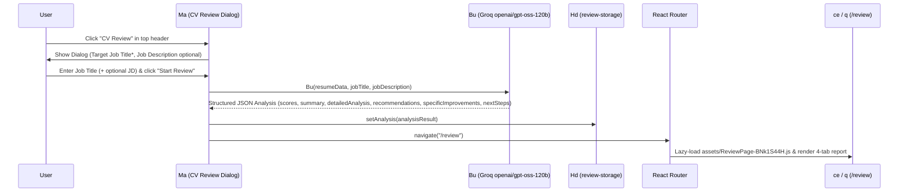

# Workflow: AI Writing Assistant and AI CV Review

**Target Application**: `https://cvmaster.app/`  
**Primary Evidence Records**:
- `ev_5c7ff687c41ba2d956c4b0ad4f650d6a8c92e69697d94efe53263f18b4201846` (`capture_browser_scenario` fetching `assets/ReviewPage-BNk1S44H.js`)
- `ev_9f1622136e724145a2541fd1139a2fbbf85723b588895c404b9a01e018973bf5` (`analyze_javascript_application` on `index-B9ESfVPA.js` and `services-Cix8ANSZ.js`)
- `ev_d4721be36551ad83b213a9ce8e88eb21139d01a77308e34ce54e9050fed14e11` (`analyze_javascript_application` on `ReviewPage-BNk1S44H.js`)

---

## 1. Embedded Tiptap AI Writing Assistant (`Xu`, `Mu`, `Lu`, `Ou`)

### Finding W-AI-01: In-Editor AI Text Enhancement Workflow
- **Description**:
  - Every rich-text `Summary` field in CVMaster (the main `Summary` accordion card and the `summary` field inside the `Experience`, `Projects`, `Education`, `Certifications`, `Awards`, and `Volunteering` modals) embeds the Tiptap toolbar (`$u`) with the `<Xu />` AI Writing Assistant dropdown (`Sparkles` icon).
  - **Minimum Length Guard**:
    - When a user clicks any AI action in `<Xu />`, it checks `editor.getText().trim().length < 30`.
    - If under 30 characters, it aborts the API call and displays a destructive toast: `"Content is too short to improve (min 30 characters)"`.
  - **AI Transformation Actions (`llama-3.1-8b-instant`)**:
    1. **`Improve Writing` (`Mu(htmlContent)`)**:
       - System prompt instructs `llama-3.1-8b-instant` (`temperature: 0.7`, `max_tokens: 1024`) to rewrite the resume text to be more impactful, action-oriented, and professional while preserving HTML structure (`<p>`, `<ul>`, `<li>`, `<strong>`, `<em>`) and returning *only* the improved HTML without markdown fences.
    2. **`Fix Typos` (`Lu(htmlContent)`)**:
       - System prompt instructs `llama-3.1-8b-instant` (`temperature: 0.3`, `max_tokens: 1024`) to fix all spelling, grammar, and punctuation errors without altering the meaning or HTML tags.
    3. **`Customize` Submenu (`Ou(htmlContent, stylePrompt)`)**:
       - Offers 6 preset transformations: `"Shorter"`, `"Longer"`, `"More Formal"`, `"More Informal"`, `"More Creative"`, `"More Technical"`.
       - Calls `llama-3.1-8b-instant` (`temperature: 0.7`, `max_tokens: 1024`) to adjust tone/length according to the selected preset while preserving HTML formatting.
  - **Post-Processing**:
    - Strips any accidental markdown code fences (`replace(/```html|```/g, "").trim()`), updates the Tiptap editor via `editor.commands.setContent(cleanedHtml)`, triggers `onChange(cleanedHtml)`, and shows toast `"Content updated successfully!"`.
- **Evidence source**:
  - `assets/index-B9ESfVPA.js` (symbols `$u`, `Xu`)
  - `assets/services-Cix8ANSZ.js` (symbols `Mu`, `Lu`, `Ou`)
- **Verification status**: `Verified` (code, prompts, model parameters, and 30-char guard); `Inferred` (live Groq API invocation requires manual human test)
- **Implementation implications**:
  - Replicate the 30-character minimum check, the 8 AI writing actions (`Improve Writing`, `Fix Typos`, and 6 `Customize` presets), and HTML tag preservation.

---

## 2. End-to-End AI CV Review Workflow (`Ma` -> `Bu` -> `/review`)



### Finding W-AI-02: CV Review Modal & Groq `openai/gpt-oss-120b` Analysis (`Ma`, `Bu`)
- **Description**:
  1. Clicking `"CV Review"` in the top navbar opens Radix `Dialog` `Ma`.
  2. The dialog form requires a `Target Job Title` (`jobTitle.trim()` required; shows toast error if empty) and an optional `Job Description` `<textarea>` (for tailored ATS keyword and role-fit evaluation).
  3. Clicking `"Start Review"` sets `isLoading = true` (`"Analyzing your CV..."`) and calls `Bu(resumeData, jobTitle, jobDescription)` in `assets/services-Cix8ANSZ.js`:
     - Strips unnecessary UI metadata from `resumeData` and sends a comprehensive evaluation prompt to Groq (`model: "openai/gpt-oss-120b"`, `temperature: 0.3`, `max_tokens: 4000`, `response_format: { type: "json_object" }`).
     - Requests a strict JSON schema containing:
       - `overallScore`: `number` (`0..100`)
       - `jobFitPercentage`: `number` (`0..100`)
       - `summary`: `{ strengths: string[], weaknesses: string[], fitLevel: "Excellent" | "Good" | "Fair" | "Poor", estimatedImprovementTime: string }`
       - `detailedAnalysis`:
         - `contentAlignment`: `{ score: number, feedback: string, matchingSkills: string[], missingSkills: string[] }`
         - `experienceRelevance`: `{ score: number, feedback: string, relevantExperiences: string[], gaps: string[] }`
         - `resumeStructure`: `{ score: number, feedback: string, improvements: string[] }`
         - `atsCompatibility`: `{ score: number, feedback: string, issues: string[], keywords: string[] }`
       - `recommendations`: `{ highPriority: string[], mediumPriority: string[], lowPriority: string[] }`
       - `specificImprovements`: `{ summary: string[], experience: string[], skills: string[], education: string[], general: string[] }`
       - `nextSteps`: `string[]`
  4. Stores the parsed JSON object in `Hd` (`localStorage["review-storage"]`) via `setAnalysis(result)`, closes the dialog, and calls `navigate("/review")`.
- **Evidence source**:
  - `assets/index-B9ESfVPA.js` (symbol `Ma`)
  - `assets/services-Cix8ANSZ.js` (symbol `Bu`)
  - `assets/state-LogT9lEE.js` (store `Hd`)
- **Verification status**: `Verified` (code, schema, and store flow); `Inferred` (live LLM execution latency/output requires manual human test)
- **Implementation implications**:
  - Validate the LLM's returned JSON against a Zod schema with safe fallback arrays (`[]`) so missing nested properties never cause runtime crashes on `/review`.

### Finding W-AI-03: Interactive 4-Tab Review Dashboard (`ReviewPage-BNk1S44H.js`)
- **Description**:
  - On `/review`, component `q` reads `analysis` from `review-storage` (`Hd`) and renders:
    1. **Top Summary Banner**: Displays `overallScore/100` and two SVG circular progress gauges (`<c />`) for `Overall Score` and `Job Fit`, plus a color-coded badge for `summary.fitLevel` (`Excellent` -> green, `Good` -> blue, `Fair` -> yellow, `Poor` -> red) and `summary.estimatedImprovementTime`.
    2. **Tab 1 — `Overview` (`J`)**:
       - Side-by-side cards for `Key Strengths` (`summary.strengths`) and `Areas for Improvement` (`summary.weaknesses`).
       - 4 KPI metric cards counting `Matching Skills`, `Missing Skills`, `High Priority Items`, and total `Action Items`.
    3. **Tab 2 — `Detailed Analysis` (`W`)**:
       - Multi-expand Radix `Accordion` (`defaultValue={["content", "experience", "structure", "ats"]}`) with 4 sections:
         - `Content Alignment`: Score gauge + feedback + green badges for `matchingSkills` and red badges for `missingSkills`.
         - `Experience Relevance`: Score gauge + feedback + `relevantExperiences` and `gaps` lists.
         - `Resume Structure`: Score gauge + feedback + `improvements` list.
         - `ATS Compatibility`: Score gauge + feedback + `issues` list and `keywords` badges.
    4. **Tab 3 — `Recommendations` (`Z`)**:
       - Three priority cards (`High Priority`, `Medium Priority`, `Low Priority`) and a numbered list of `Immediate Next Steps` (`nextSteps`).
    5. **Tab 4 — `Improvements` (`Q`)**:
       - Groups actionable items by resume section (`summary`, `experience`, `skills`, `education`, `general`) with interactive Radix `Checkbox` (`<C />`) controls that strike through completed items (`peer-data-[state=checked]:line-through`).
- **Evidence source**:
  - `assets/ReviewPage-BNk1S44H.js` (`20,237` B, SHA256 `8b36c0f57433369c5ed397f97437a3c9d9e70d0c9562e390155893915c45e4f0`, symbols `ce`, `q`, `c`, `b`, `C`, `J`, `W`, `Z`, `Q`)
  - `ev_5c7ff687c41ba2d956c4b0ad4f650d6a8c92e69697d94efe53263f18b4201846`
- **Verification status**: `Verified`
- **Implementation implications**:
  - Replicate all 4 tabs, the circular SVG score gauges, and the interactive improvement checklist (with persisted checkbox state in `review-storage`).
