# Workflow: CV Creation and Editing

**Target Application**: `https://cvmaster.app/`  
**Primary Evidence Records**:
- `ev_fa6d6e41c78e797a47fa1b2f2b72a9d47c21a4d92c833522fd2fe363d8fc5950` (`inspect_web_page` DOM & AX tree)
- `ev_9f1622136e724145a2541fd1139a2fbbf85723b588895c404b9a01e018973bf5` (`analyze_javascript_application` on `index-B9ESfVPA.js` and `state-LogT9lEE.js`)

---

## 1. Initial CV Creation (Default Template Hydration)

### Finding W-EDIT-01: Zero-Friction Initialization with Pre-Populated Resume (`zd`)
- **Description**:
  - There is no `"Create New CV"` wizard or onboarding questionnaire. Navigating to `https://cvmaster.app/` immediately initializes the `Y` (`cv-storage`) Zustand store with a comprehensive sample resume (`zd`) for `"John Doe"` (`"Full Stack Web Developer"`, `"john.doe@example.com"`, `"+1 (555) 123-4567"`, `"San Francisco, CA"`), containing pre-populated entries across all 9 sections (`Summary`, `Experience`, `Projects`, `Education`, `Skills`, `Languages`, `Certifications`, `Awards`, `Volunteering`).
  - Every keystroke or mutation in the left sidebar (`up`) immediately updates `cv-storage` in `localStorage` and re-renders the `#cv-preview` A4 canvas in real time.
- **Evidence source**:
  - `assets/state-LogT9lEE.js` (symbol `zd`, store `Y`)
  - `ev_fa6d6e41c78e797a47fa1b2f2b72a9d47c21a4d92c833522fd2fe363d8fc5950` (DOM `#cv-preview` rendered with `"John Doe"`)
- **Verification status**: `Verified`
- **Implementation implications**:
  - Seed the store with a rich, realistic default resume so first-time visitors immediately see how every section renders on the A4 sheet.

---

## 2. Editing Personal Basics, Photo & Custom Contact Fields

### Finding W-EDIT-02: Basics Accordion Editing & Contact Line-Break Controls (`dp`, `op`)
- **Description**:
  1. Expanding the `"Basics"` accordion card (`dp`) in the left sidebar reveals inputs bound directly to `resumeData.basics` via `updateBasics`:
     - `Full Name` (`basics.name`)
     - `Title` (`basics.title`)
     - `Email` (`basics.email`)
     - `Website` (`basics.website`)
     - `LinkedIn` (`basics.linkedin`)
     - `Phone` (`basics.phone.value`) + `"Break Line After"` switch (`basics.phone.breakAfter`)
     - `Location` (`basics.location.value`) + `"Break Line After"` switch (`basics.location.breakAfter`)
  2. **Custom Fields (`op`)**:
     - Users enter a `Field Name` (e.g., `"GitHub"`) and `Field Value` (e.g., `"github.com/johndoe"`) and click `"Add Custom Field"`, which calls `addCustomField({ id: Date.now().toString(), name, value, breakAfter: false })`.
     - Each added custom field appears in a list with a `"Break"` switch (`updateCustomField(id, { breakAfter })`) and a delete button (`removeCustomField(id)`).
  3. **Preview Effect**:
     - In `eu` (Basics header preview), contact fields are rendered inline separated by `|`. Any field with `breakAfter: true` injects `
` immediately after that field, forcing subsequent contact items onto a new centered/aligned line.
- **Evidence source**:
  - `assets/index-B9ESfVPA.js` (symbols `dp`, `op`, `eu`)
  - `assets/state-LogT9lEE.js` (actions `updateBasics`, `addCustomField`, `updateCustomField`, `removeCustomField`)
- **Verification status**: `Verified`
- **Implementation implications**:
  - Implement both the standard contact fields and arbitrary `customFields` with per-item `breakAfter` flex-wrap break elements.

### Finding W-EDIT-03: Profile Photo Upload & Styling Workflow (`ip`)
- **Description**:
  1. Inside the `"Basics"` accordion card, component `ip` provides an `"Upload Photo"` button (`Maximum size: 2MB. Formats: PNG, JPG, JPEG, WebP`) that triggers hidden `<input type="file" id="photo-upload">`.
  2. When a user selects a file:
     - Validates `["image/png", "image/jpeg", "image/jpg", "image/webp"].includes(file.type)` (toast error `"Please select a valid image file (PNG, JPG, JPEG, or WebP)"` on failure).
     - Validates `file.size <= 2 * 1024 * 1024` (toast error `"Image size should be less than 2MB"` on failure).
     - Reads the file as a base64 DataURL via `FileReader.readAsDataURL(file)`.
     - Sends `POST https://cvmaster-backend.vercel.app/upload-photo` with `{ image: base64DataUrl }`.
     - On HTTP `200`, updates `basics.photo.url = data.url` and displays toast `"Photo uploaded successfully"`.
  3. Once `basics.photo.url` is non-empty, additional photo controls appear:
     - `Size` slider (`50` to `150` px, step `5`, default `100` px)
     - `Border Radius` slider (`0` to `50` %, step `5`, default `50` % for circle)
     - `Visible` switch (`basics.photo.visible`, allowing temporary hiding without deleting the URL)
     - `Remove` button (clears `basics.photo.url = ""`).
- **Evidence source**:
  - `assets/index-B9ESfVPA.js` (symbol `ip`)
- **Verification status**: `Verified` (code & network contract); `Inferred` (live server response from `/upload-photo` requires manual file upload test)
- **Implementation implications**:
  - Support client-side DataURL storage (or optional image compression/upload) so photo upload works completely offline and without external backend dependencies.

---

## 3. Section Management: Rename, Add, Edit, Hide & Delete

```mermaid
sequenceDiagram
    participant User
    participant SectionCard as cp / ap (Accordion Card)
    participant Modal as fp..Tp (Zod Form Dialog)
    participant Store as Y (cv-storage)
    participant Preview as $r (#cv-preview)

    User->>SectionCard: Click Pencil icon next to section title
    SectionCard->>User: Show inline title <input>
    User->>SectionCard: Edit title & click Check (or press Enter)
    SectionCard->>Store: updateSectionTitle(sectionKey, newTitle)
    Store->>Preview: Re-render section heading

    User->>SectionCard: Click "Add <Section>" (or "Edit" in item 3-dot menu)
    SectionCard->>Modal: Open Dialog (empty defaults or existing item)
    User->>Modal: Fill fields, toggle "Current", reorder keyword chips, edit Tiptap summary
    User->>Modal: Click Save / Add
    Modal->>Modal: Validate via Zod schema (Id..Dd)
    Modal->>Store: addSectionItem / updateSectionItem
    Store->>Preview: Immediately render updated item

    User->>SectionCard: Open item 3-dot menu -> "Hide from PDF"
    SectionCard->>Store: toggleHideItem(item.id)
    Store->>Preview: Filter out item.id from rendered items
```

### Finding W-EDIT-04: Inline Section Title Renaming (`cp`)
- **Description**:
  - Every section accordion card (`summary`, `experience`, `projects`, `education`, `skills`, `languages`, `certifications`, `awards`, `volunteering`) displays a pencil (`Edit2`) button next to its title in the accordion header.
  - Clicking the pencil icon stops accordion toggle propagation (`e.stopPropagation()`) and replaces the heading label with an `<input>` pre-filled with `resumeData[sectionKey].title`, plus confirm (`Check`) and cancel (`X`) buttons.
  - Confirming calls `updateSectionTitle(sectionKey, trimmedTitle)`, updating both the sidebar card header, the `Controls` drag-and-drop list label, and the uppercase section header on the A4 preview sheet.
- **Evidence source**:
  - `assets/index-B9ESfVPA.js` (symbol `cp`)
  - `assets/state-LogT9lEE.js` (action `updateSectionTitle`)
- **Verification status**: `Verified`
- **Implementation implications**:
  - Allow every section heading to be renamed inline so users can localize headings or adapt terminology (e.g., `"Work History"` vs. `"Experience"`).

### Finding W-EDIT-05: Rich-Text Summary Editing & List Section Item CRUD (`cp`, `ap`, `fp`–`Tp`)
- **Description**:
  1. **Summary Section (`sectionKey === "summary"`)**:
     - Expanding the `"Summary"` card directly shows the Tiptap rich-text editor (`<Ue />`) with formatting controls (`Bold`, `Italic`, `Bullet List`, `Ordered List`, `Link`, `Undo`, `Redo`) and the AI Writing Assistant (`<Xu />`). Changes call `updateSummary(html)`.
  2. **List Sections (`experience`, `projects`, `education`, `skills`, `languages`, `certifications`, `awards`, `volunteering`)**:
     - Clicking `"Add <Section>"` opens the corresponding modal dialog (`fp`..`Tp`).
     - In modals with date ranges (`Experience`, `Projects`, `Education`, `Volunteering`), checking `"Currently working/studying here"` (`current: true`) automatically sets `endDate` to `"Present"` and disables the `endDate` input.
     - In modals with tag arrays (`Projects` -> `keywords`, `Education` -> `courses`, `Skills` -> `keywords`), users add tags via `<mp />` and drag-and-drop chips (`<yp />`) to reorder them.
     - Submitting validates fields through the section's Zod schema (`Id`..`Dd`), saves to `cv-storage`, closes the dialog, and shows a confirmation toast.
  3. **Item Actions (`ap` 3-Dot Dropdown Menu)**:
     - **Edit**: Opens the section modal populated with the item's current values.
     - **Hide from PDF / Show in PDF**: Calls `toggleHideItem(item.id)`, adding/removing `item.id` in `hiddenItemIds`. Hidden items remain editable in the sidebar (with a visual indicator) but are excluded from `#cv-preview` and exported PDFs.
     - **Delete**: Calls `deleteSectionItem(sectionKey, item.id)`.
- **Evidence source**:
  - `assets/index-B9ESfVPA.js` (symbols `cp`, `ap`, `fp`, `gp`, `vp`, `jp`, `bp`, `Sp`, `Pp`, `Tp`, `mp`, `yp`)
  - `assets/state-LogT9lEE.js` (schemas `Id`, `$d`, `Cd`, `kd`, `Md`, `Nd`, `Td`, `Dd`)
- **Verification status**: `Verified`
- **Implementation implications**:
  - Support non-destructive item hiding (`hiddenItemIds`) so users can tailor a master resume to different roles without deleting entries.

---

## 4. Resetting the Resume

### Finding W-EDIT-06: Destructive Reset Confirmation (`Kp`)
- **Description**:
  - Clicking `"Reset"` in the top header opens a Radix `AlertDialog` (`Kp`) asking `"Are you sure you want to reset your resume? This will replace all your current data with the default template and cannot be undone."`.
  - Clicking `"Reset"` inside the modal invokes `resetAll()` on `cv-storage`, restoring `zd` (`John Doe`), `Qd` (default section order), and `hiddenItemIds: []`, and displays toast `"Resume reset successfully"`. Note that `resetAll()` resets `cv-storage` but does not reset `controls-storage` (typography/margin settings).
- **Evidence source**:
  - `assets/index-B9ESfVPA.js` (symbol `Kp`)
  - `assets/state-LogT9lEE.js` (action `resetAll`)
- **Verification status**: `Verified`
- **Implementation implications**:
  - Provide clear reset confirmation; optionally allow resetting either resume content, styling controls, or both.
