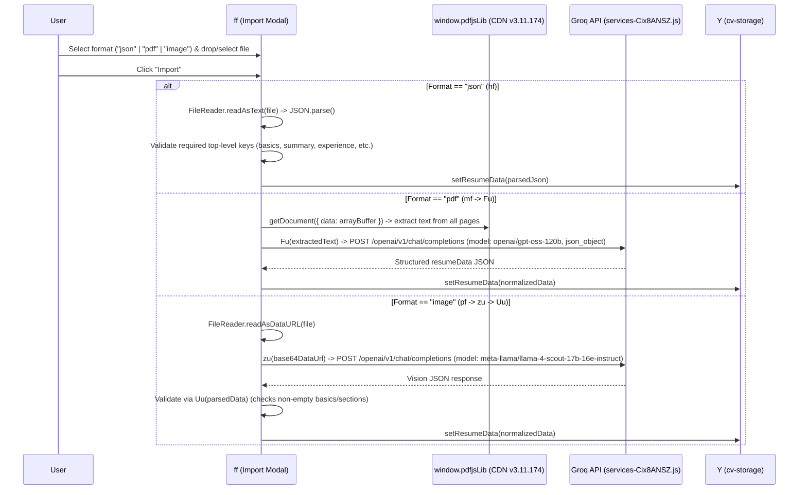

# Workflow: Resume Import (JSON, PDF, Image) and Export (PDF, JSON)

**Target Application**: `https://cvmaster.app/`  
**Primary Evidence Records**:
- `ev_2445cd04bdd6a6f1425a8803718dcca48c3471c84a269d7b60cf7118bbf153d8` (`capture_browser_scenario` initial asset capture including `pdf.min.js`)
- `ev_9f1622136e724145a2541fd1139a2fbbf85723b588895c404b9a01e018973bf5` (`analyze_javascript_application` on `index-B9ESfVPA.js` and `services-Cix8ANSZ.js`)

---

## 1. Resume Import Workflows (`ff`, `hf`, `mf`, `pf`, `Fu`, `zu`, `Uu`)

### Finding W-IO-01: Import Modal & Format Selection (`ff`)
- **Description**:
  - Clicking `"Import"` in the top header opens a Radix `Dialog` (`ff`) titled `"Import Resume"`.
  - Users choose an import source via a 3-option radio group:
    1. **JSON File (`"json"`)**: Accepts `.json` (`application/json`).
    2. **PDF Resume (`"pdf"`)**: Accepts `.pdf` (`application/pdf`), labeled with an AI badge (`"AI Powered"`).
    3. **Image Resume (`"image"`)**: Accepts `image/*` (`.png, .jpg, .jpeg, .webp`), labeled with an AI badge (`"AI Powered"`).
  - Provides a drag-and-drop dropzone (`onDragOver`, `onDrop`) and click-to-browse `<input type="file">`.
- **Evidence source**:
  - `assets/index-B9ESfVPA.js` (symbol `ff`)
- **Verification status**: `Verified`
- **Implementation implications**:
  - Provide a unified import dialog supporting JSON, PDF, and Image uploads with clear progress states during AI extraction.

### Finding W-IO-02: Client-Side JSON Import (`hf`)
- **Description**:
  - Reads the `.json` file via `file.text()` / `FileReader`, parses with `JSON.parse`, verifies the presence of core schema keys (`basics`, `summary`, `experience`, `education`, `skills`), and calls `setResumeData(data)` on `cv-storage`, followed by toast `"Resume imported successfully!"`.
- **Evidence source**:
  - `assets/index-B9ESfVPA.js` (symbol `hf`)
- **Verification status**: `Verified`
- **Implementation implications**:
  - Validate imported JSON with a full Zod schema for `resumeData` and fill in any missing optional fields with safe defaults so partial JSON imports never crash the renderer.

### Finding W-IO-03: Client-Side `pdf.js` Text Extraction + Groq `openai/gpt-oss-120b` PDF Import (`mf`, `Fu`)
- **Description**:
  1. `mf` verifies `window.pdfjsLib` (loaded from `https://cdnjs.cloudflare.com/ajax/libs/pdf.js/3.11.174/pdf.min.js` in `index.html`) and sets `pdfjsLib.GlobalWorkerOptions.workerSrc = "https://cdnjs.cloudflare.com/ajax/libs/pdf.js/3.11.174/pdf.worker.min.js"`.
  2. Converts the uploaded PDF file to an `ArrayBuffer`, loads the document via `pdfjsLib.getDocument({ data: arrayBuffer }).promise`, and iterates through pages `1..numPages`, calling `page.getTextContent()` and joining `item.str` tokens into a single `fullText` string.
  3. If `fullText.trim()` is empty, throws an error (`"Could not extract text from PDF. It might be a scanned image."`).
  4. Passes `fullText` to `Fu(fullText)` in `assets/services-Cix8ANSZ.js`, which calls Groq (`model: "openai/gpt-oss-120b"`, `temperature: 0.2`, `max_tokens: 4000`, `response_format: { type: "json_object" }`) with a detailed system prompt instructing the model to map all extracted resume information into CVMaster's exact `resumeData` JSON schema (generating unique IDs and HTML `
`/`<ul>`/`<li>` summaries).
  5. Calls `setResumeData(parsedResume)` and closes the dialog.
- **Evidence source**:
  - `assets/index-B9ESfVPA.js` (symbol `mf`)
  - `assets/services-Cix8ANSZ.js` (symbol `Fu`)
  - `ev_2445cd04bdd6a6f1425a8803718dcca48c3471c84a269d7b60cf7118bbf153d8` (`index.html` script tag for `pdf.min.js`)
- **Verification status**: `Verified` (code, worker URL, prompt, and model); `Inferred` (live PDF upload & LLM extraction requires manual human test)
- **Implementation implications**:
  - Bundle `pdfjs-dist` locally (or via a reliable worker) and run LLM structured extraction via a backend API endpoint using Zod `response_format` / JSON schema validation.

### Finding W-IO-04: Groq Vision (`meta-llama/llama-4-scout-17b-16e-instruct`) Image Import & Heuristic Validator (`pf`, `zu`, `Uu`)
- **Description**:
  1. `pf` reads the selected image file as a base64 DataURL (`data:image/...;base64,...`) and passes it to `zu(base64Image)` in `assets/services-Cix8ANSZ.js`.
  2. `zu` sends a multimodal chat completion request to Groq using `model: "meta-llama/llama-4-scout-17b-16e-instruct"` (`temperature: 0.2`, `max_tokens: 4000`) with message content `[{ type: "text", text: prompt }, { type: "image_url", image_url: { url: base64Image } }]`.
  3. Extracts the JSON block from the response (`content.match(/\{[\s\S]*\}/)`) and runs `Uu(parsedData)`—a heuristic validator that checks whether the image actually contained a resume by verifying if `basics.name` or `basics.email` is non-empty and at least one section (`summary.content`, `experience.items`, `education.items`, `skills.items`, `projects.items`) has content. If `Uu` returns `false`, throws `"The uploaded image does not appear to be a valid resume"`.
  4. On success, merges defaults and updates `cv-storage` via `setResumeData`.
- **Evidence source**:
  - `assets/index-B9ESfVPA.js` (symbol `pf`)
  - `assets/services-Cix8ANSZ.js` (symbols `zu`, `Uu`)
- **Verification status**: `Verified` (code, vision model, prompt, and `Uu` validator); `Inferred` (live image upload requires manual human test)
- **Implementation implications**:
  - Include the `Uu` non-empty resume heuristic check when importing from Vision models so non-resume images fail gracefully with a clear error message.

---

## 2. Resume Export Workflows (`gf`)

### Finding W-IO-05: Server-Side PDF Export (`POST /pdf`) & Silent Background Upload (`POST /upload-pdf`)
- **Description**:
  - Clicking `"Export"` -> `"PDF"` in `gf` executes the following sequence:
    1. Sets `isExporting = true` (disables button and shows spinner `"Exporting..."`).
    2. Clones `#cv-preview` (`document.getElementById("cv-preview").cloneNode(true)`), removes any page-break indicator elements (`[data-page-break]`, `.border-red-400`), and resets transform/shadow styles on the clone.
    3. Wraps the clone's `outerHTML` in a standalone HTML document string (`htmlContent`) that includes:
       - `<link href="https://cdn.jsdelivr.net/npm/tailwindcss@2.2.19/dist/tailwind.min.css" rel="stylesheet">`
       - `<link href="https://fonts.googleapis.com/css?family=${fontFamily.replace(/\s+/g, "+")}:400,500,600,700&display=swap" rel="stylesheet">`
       - Inline `<style>` rules for `@page { size: A4; margin: 0; }`, `body { font-family: '${fontFamily}', sans-serif; }`, and `.prose` list/paragraph spacing.
    4. Sends `POST https://cvmaster-backend.vercel.app/pdf` with JSON body `{ htmlContent, margin: margin.VALUE }`.
    5. Receives the binary PDF blob (`await response.blob()`), creates an object URL (`URL.createObjectURL(blob)`), triggers a download named `${(resumeData.basics.name || "Resume").replace(/\s+/g, "_")}_CV.pdf`, and shows toast `"PDF exported successfully!"`.
    6. **Silent Background Archiving**: Converts `blob` to a base64 DataURL via `FileReader.readAsDataURL(blob)` and fires an unawaited `POST https://cvmaster-backend.vercel.app/upload-pdf` with `{ pdf: base64DataUrl, name: resumeData.basics.name, title: resumeData.basics.title, uuid }`.
- **Evidence source**:
  - `assets/index-B9ESfVPA.js` (symbol `gf`, constant `pf = "https://cvmaster-backend.vercel.app"`)
- **Verification status**: `Verified` (code & payload structure); `Inferred` (live PDF binary output from `cvmaster-backend.vercel.app/pdf` requires manual click verification)
- **Implementation implications**:
  - In our clean-room implementation, provide high-fidelity PDF generation (via Playwright/Puppeteer backend route or native browser `@media print` / `window.print()` fallback) **without** the undocumented silent `/upload-pdf` exfiltration call.

### Finding W-IO-06: Client-Side JSON Export (`gf`)
- **Description**:
  - Clicking `"Export"` -> `"JSON"` serializes `resumeData` via `JSON.stringify(resumeData, null, 2)`, wraps it in a `Blob` (`application/json`), and triggers an anchor download named `${(resumeData.basics.name || "Resume").replace(/\s+/g, "_")}_CV.json`.
- **Evidence source**:
  - `assets/index-B9ESfVPA.js` (symbol `gf`)
- **Verification status**: `Verified`
- **Implementation implications**:
  - Implement instant client-side JSON export with the same `<Name>_CV.json` naming convention.
